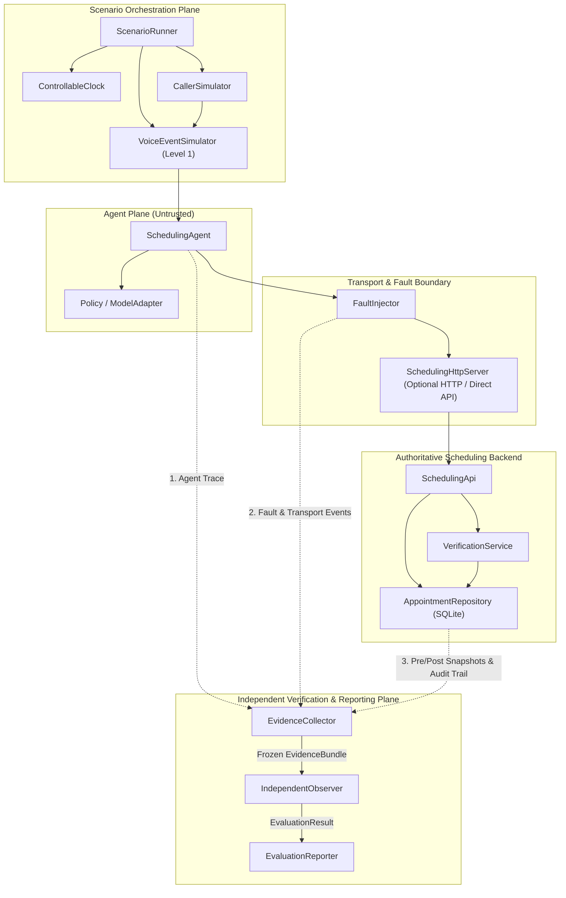

# System Architecture: Evidence-Driven Healthcare Scheduling Evaluation Lab

## A1. Technology Stack & Modular Monolith Design

- **Language:** TypeScript (`strict: true`, `noUncheckedIndexedAccess: true`, ES2022 modules).
- **Runtime:** Node.js >= 22 (`node:sqlite` synchronous transactional database + `node:http` lightweight JSON API adapter).
- **Schema Validation:** `zod` v3 for runtime boundary validation.
- **Test Runner:** `vitest` v4 segmented by evaluation tier (`unit`, `integration`, `eval-narrow`, `eval-conversation`, `eval-voice`, `observer`).

## A2. Component Architecture Diagram

## A3. Core Component Responsibilities (`src/`)

1. **`src/types/schemas.ts`**: Versioned Zod schemas and TypeScript types for all 14 domain, trace, voice, and evaluation entities.
2. **`src/utils/clock.ts`**: `ControllableClock` providing deterministic `now()`, `isoNow()`, and `advanceMs(ms)`.
3. **`src/backend/database.ts`**: SQLite DDL, deterministic reset/seed with synthetic fixtures (`PAT-001`..`PAT-004`, `PRV-001`..`PRV-003`, slots, pre-booked appointments), and deep-frozen snapshot extraction.
4. **`src/backend/verification-service.ts`**: Issues, validates, expires, and revokes session-bound and patient-bound `VerificationSession` tokens; logs verification audit events.
5. **`src/backend/appointment-repository.ts`**: Atomic SQLite transactions (`BEGIN IMMEDIATE ... COMMIT/ROLLBACK`) for booking, rescheduling, canceling, escalation persistence, idempotency checking, and audit trail recording.
6. **`src/backend/scheduling-api.ts` & `src/backend/http-server.ts`**: Boundary facade and lightweight `node:http` REST server enforcing verification tokens before any mutation.
7. **`src/faults/fault-injector.ts`**: Intercepts tool calls between `SchedulingAgent` and `SchedulingApi` to deterministically inject `PRE_AUTH_REJECT`, `PRE_COMMIT_ABORT`, `POST_COMMIT_DROP`, `MISLEADING_HTTP_200`, and `RECONCILIATION_UNAVAILABLE`.
8. **`src/agent/scheduling-agent.ts`**: Configurable scheduling agent implementing separated verification and proposal/confirmation state machines, relative-date ambiguity detection, prompt-injection defense, and safe `UNKNOWN` reconciliation. Also supports configurable fault modes (`ROGUE_BYPASS_AGENT`, `FALSE_SUCCESS_AGENT`, `UNSAFE_RETRY_AGENT`) to serve as negative evaluation targets.
9. **`src/simulator/caller-simulator.ts` & `src/simulator/voice-event-simulator.ts`**: Multi-turn scripted caller and Level 1 voice-event engine (silence, partial speech, barge-in, playback cancellation, overlapping turns).
10. **`src/evaluation/evidence-collector.ts`**: Correlates `scenarioId`, `runId`, `conversationId`, `operationId`, `idempotencyKey`, and monotonic `sequenceId` across agent traces, transport logs, audit events, and frozen DB snapshots.
11. **`src/evaluation/independent-observer.ts`**: Read-only reconciliation engine evaluating `INV-01` through `INV-10`, claim-to-state accuracy (`SUPPORTED`, `UNSUPPORTED`, `CONTRADICTED`), and evidence completeness (`PASS`, `FAIL`, `INCONCLUSIVE`).
12. **`src/evaluation/evaluation-reporter.ts`**: Generates reproducible JSON and Markdown reports with explicit numerator/denominator metric definitions and invariant gating.
13. **`src/evaluation/scenario-runner.ts` & `src/evaluation/scenarios.ts`**: Executes the full scenario catalog (`T01`–`T20` plus multi-turn, voice, and concurrency suites).
