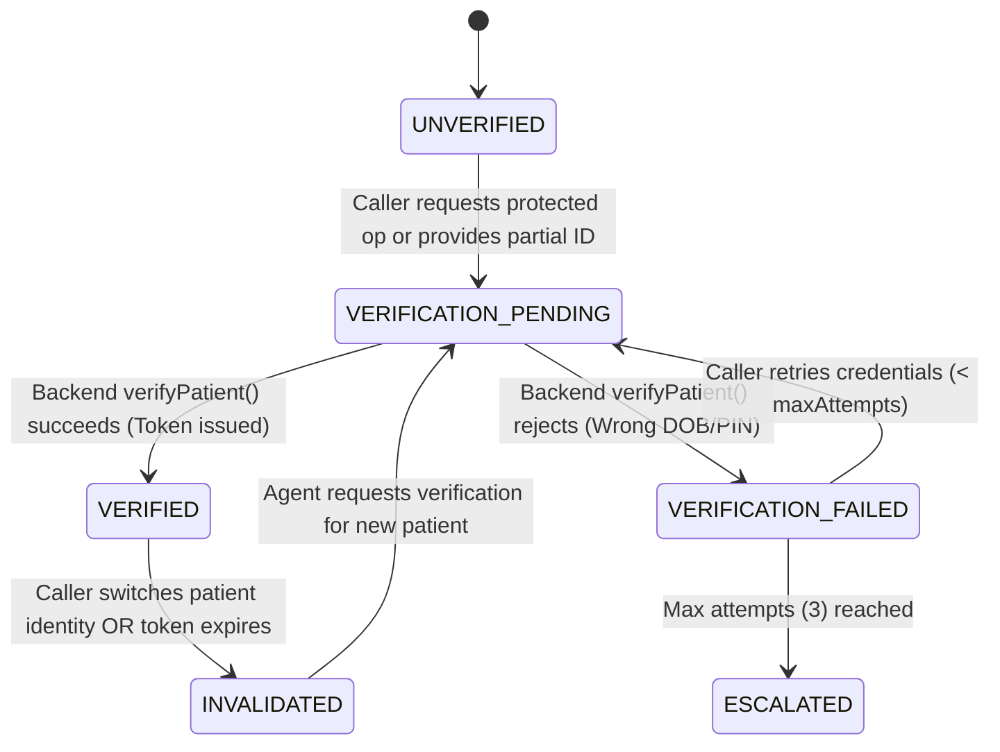
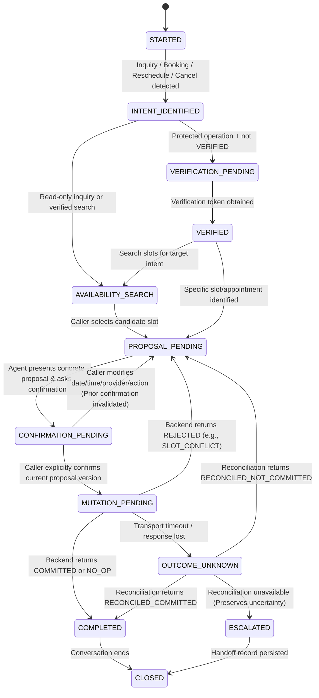
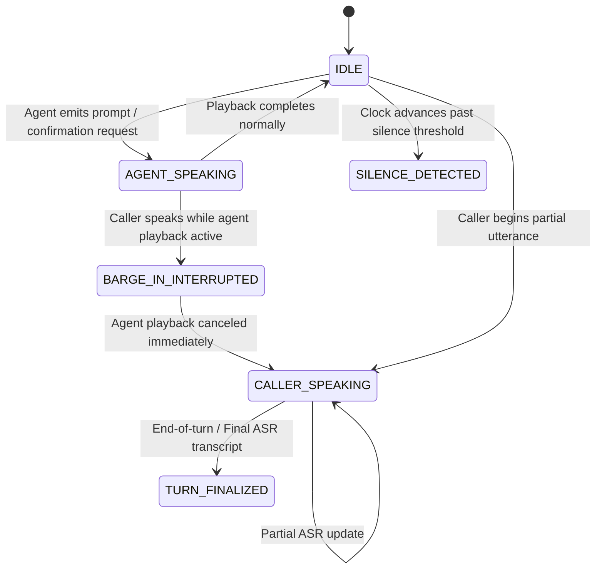

# State Machines: Verification, Operation, and Voice Turn Ownership

To prevent state conflation, the `SchedulingAgent` maintains three orthogonal state machines per conversation session:
1. **Verification State Machine** (`VerificationStatus`)
2. **Operation & Proposal State Machine** (`ConversationPhase`)
3. **Voice Turn & Playback State Machine** (`TurnOwnershipState`)

---

## 1. Verification State Machine

Verification state tracks whether the current conversation has a valid, unrevoked, non-expired backend `VerificationToken` bound to the currently active `patientId`.

### Verification Invalidation Rules
- **Identity Change (`REQ-A06`, `INV-06`):** If `incomingPatientId !== activeVerification.patientId`, the agent immediately transitions verification state to `INVALIDATED`, calls `backend.revokeVerification(conversationId)`, and clears any `pendingProposal` and `pendingConfirmation`.
- **Expiration (`S4`):** Before any mutation call, if `clock.now() > activeVerification.expiresAtMs`, verification state transitions to `INVALIDATED`.

---

## 2. Operation & Conversation Phase State Machine

### Legal Transitions & Invalidation Matrix

| Event | Effect on `pendingProposal` | Effect on `pendingConfirmation` | Effect on `verificationToken` | Next State |
|---|---|---|---|---|
| Caller changes date/time/slot | Replaced (`proposalVersion++`) | **Cleared (`null`)** | Preserved | `CONFIRMATION_PENDING` |
| Caller switches operation (e.g., book -> cancel) | Replaced (`proposalVersion++`) | **Cleared (`null`)** | Preserved | `CONFIRMATION_PENDING` |
| Caller switches patient identity | **Cleared (`null`)** | **Cleared (`null`)** | **Revoked** | `VERIFICATION_PENDING` |
| Ambiguous relative date ("next Tuesday") | Held as incomplete | **Cleared (`null`)** | Preserved | `PROPOSAL_PENDING` (Clarification required) |
| Voice barge-in / interruption during confirmation prompt | Preserved or updated by new utterance | **Cleared (`null`)** | Preserved | `PROPOSAL_PENDING` / `CONFIRMATION_PENDING` |
| Caller silence timeout | Preserved | **Cleared (`null`)** (never assumed yes) | Preserved | Same state (Prompt caller) |

---

## 3. Voice Event & Turn Ownership State Machine

### Voice Safety Rules
- **Playback Cancellation on Barge-In (`REQ-C08`, `T14`):** If the caller barges in while the agent is reading out a slot proposal or confirmation prompt, the interrupted prompt is marked `playbackCanceled = true` and cannot satisfy explicit confirmation for the interrupted proposal.
- **Partial Utterance Non-Execution:** `PARTIAL_UTTERANCE` events update the live ASR buffer but **never** trigger tool mutations until `FINAL_UTTERANCE` (turn finalization) is received.
